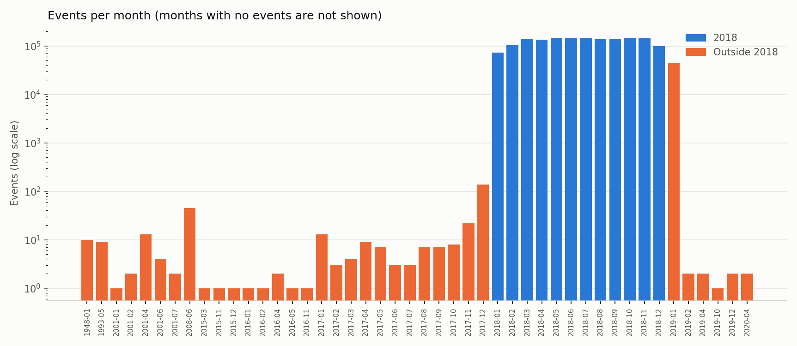
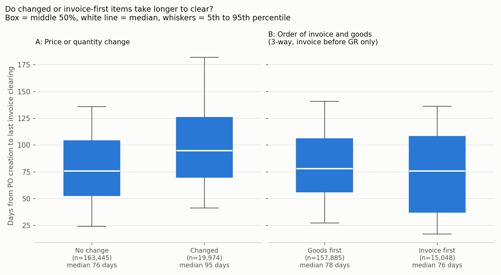
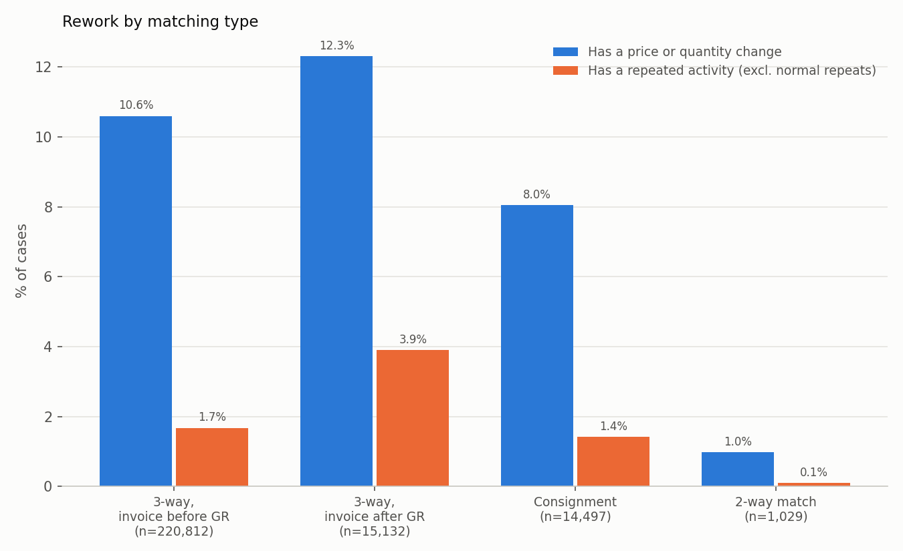
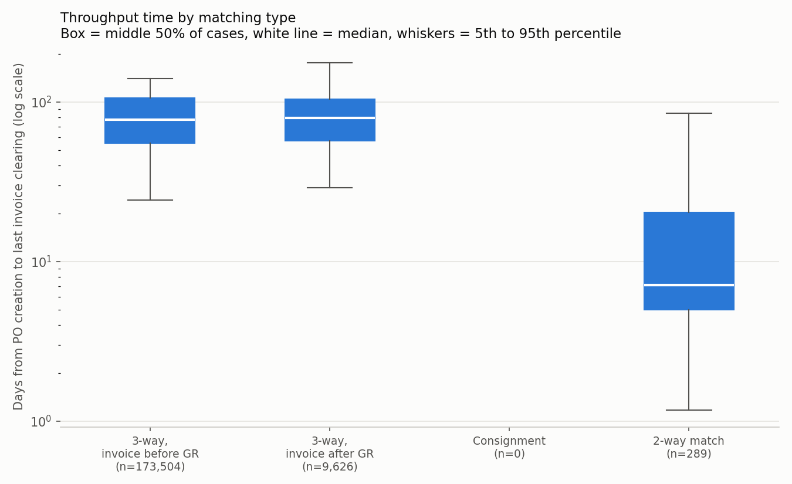
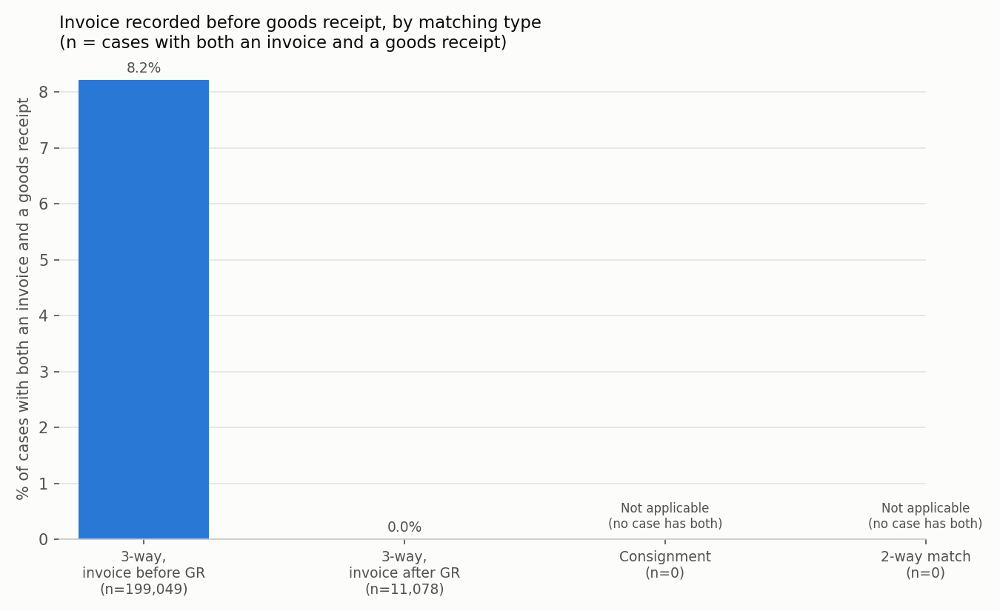
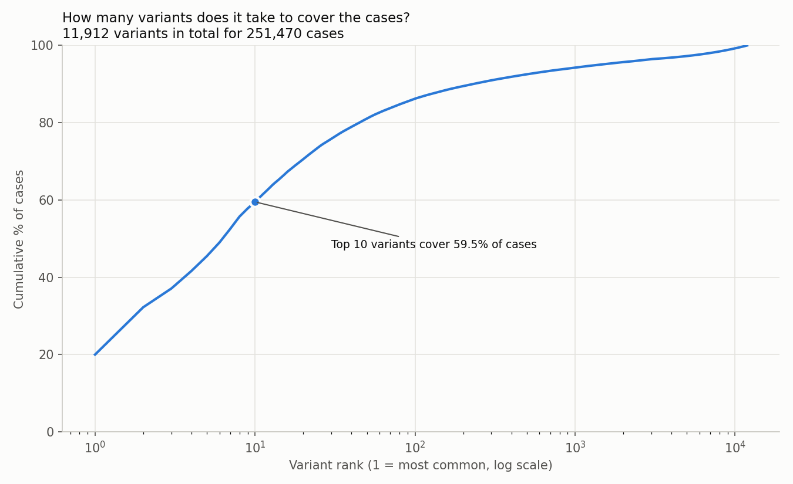
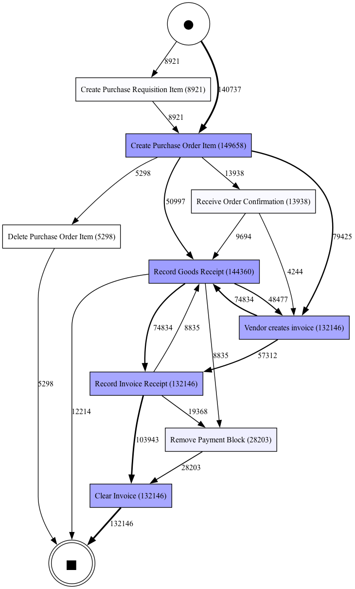

::: {.callout-note appearance="simple" icon="false"}
## Summary

I analysed a year of purchasing records from a multinational coatings and paints
manufacturer: **251,734 order lines and 1.6 million recorded steps**. The goal was to
find where the order-to-payment process slows down, where work is redone, and whether
the company's payment controls are followed.

- **Order lines that are corrected after ordering take 19 days (25%) longer to pay.**
  About 1 in 10 lines is corrected.
- **Recording an invoice before the goods arrive does not slow payment down**, but it puts
  the payment on hold 97% of the time, and a person has to release that hold in 43.5% of
  these lines, compared with 17.2% otherwise.
- **The strictest payment control is followed 100% of the time** and costs no extra time.
- **Ten process paths cover 60% of all order lines**, out of 11,912 distinct paths.

My hypothesis was **partly supported**: price and quantity changes do slow payment;
invoicing before goods receipt does not.
:::

# The business problem

Every company that buys materials follows the same routine, called
**purchase-to-pay**:

1. **Order.** Someone creates a purchase order with a supplier.
2. **Receive.** The supplier delivers, and the warehouse records the goods receipt.
3. **Bill.** The supplier sends an invoice, and accounts payable records it.
4. **Pay.** The company pays the invoice.

Before paying, most companies run a check called **matching**: does the invoice agree
with what was ordered and what was actually received? This prevents paying for goods
that never arrived or paying the wrong price. The company in this dataset uses four
kinds of check:

| Matching type | Check before paying | Typical use |
|:---|:---|:---|
| 3-way match, invoice after goods receipt | Order, delivery and invoice must agree; the invoice can only be recorded once the goods are in | Physical goods (strictest) |
| 3-way match, invoice before goods receipt | Same check, but the invoice may be recorded first and is held until the goods arrive | Physical goods |
| 2-way match | Order and invoice must agree; there is no delivery to check | Services |
| Consignment | Supplier-owned stock on site; paid for when used and invoiced separately | Stock held on site |

: Matching types in the dataset {#tbl-matching}

When this process runs badly, cash planning gets harder, accounts payable spends time
on manual fixes, and suppliers are paid late or incorrectly. Managers usually see the
process as it was *designed*. System event logs show how it *actually* runs.

**Questions I set out to answer:**

- How long does it take from creating an order to paying for it, and does that differ
  by matching type?
- How often is work redone, such as price or quantity corrections?
- Are the matching controls followed?
- What does the normal path look like, and which exceptions are common?

**Hypothesis.** Items with price or quantity changes after the purchase order is
created, and items invoiced before goods receipt, take noticeably longer to clear and
account for most of the rework.

# Data and validation

**Source.** BPI Challenge 2019 event log: purchase order handling at a multinational
coatings and paints company, 2018. van Dongen, B.F. (2019). *BPI Challenge 2019*.
4TU.ResearchData. <https://doi.org/10.4121/uuid:d06aff4b-79f0-45e6-8ec8-e19730c248f1>

Each **case** is one purchase order line. Each **event** is one step in that line's
history (for example "Record Goods Receipt") with a timestamp. Each case also carries
its matching type.

**Validation.** I loaded the file from a community mirror, so I checked it against the
official figures first. The counts match exactly:

| | Official | My load |
|:---|:---|:---|
| Events | 1,595,923 | 1,595,923 |
| Cases (order lines) | 251,734 | 251,734 |
| Distinct activities | | 42 |

: Validation of the loaded event log {#tbl-validation}

Every case has exactly one "Create Purchase Order Item" event, which confirms that one
case equals one order line.

**Date quality.** The data is described as 2018, but timestamps range from 1948 to 2020.

- **45,137 events fall after 2018**, almost all in January 2019. These are 2018 orders
  that finished after New Year. I **kept** them, because dropping them would remove the
  slowest orders and make the process look faster than it is.
- **318 events fall before 2018**, including dates in 1948, 1993 and 2001. These are
  data-entry errors. I **excluded the 264 cases** that contain them (0.1% of cases).

{#fig-months}

After filtering, **251,470 order lines** remain. The matching types are very unequal in size:

| Matching type | Order lines | Share |
|:---|:---|:---|
| 3-way, invoice before goods receipt | 220,812 | 87.8% |
| 3-way, invoice after goods receipt | 15,132 | 6.0% |
| Consignment | 14,497 | 5.8% |
| 2-way match | 1,029 | 0.4% |

: Order lines by matching type after filtering {#tbl-types}

# Approach

The analysis is three Python scripts, run in order:

1. **Load and profile** (`01_load_profile.py`). Read the 730 MB event log once, check
   the counts and dates, and save a 13 MB copy for fast reloading.
2. **Compare matching types** (`02_matching_types.py`). Build one row of measures per
   order line, compare the four types, and test the hypothesis.
3. **Variants and process map** (`03_variants.py`). Find the distinct paths order lines
   take, and map the most common ones.

**Measures**

- **Order-to-payment time:** days from the first "Create Purchase Order Item" to the
  last "Clear Invoice". Only lines that have both events are measured (183,419 lines).
- **Rework:** a price or quantity change, or an unusual repeated step. Steps that
  legitimately repeat (partial deliveries, instalment invoices, approval rounds) are not
  counted as rework.
- **Invoice before goods:** the first recorded invoice is earlier than the first goods
  receipt.

**Tools:** Python, pandas (data tables), pm4py (process mining), matplotlib (charts),
Graphviz (process map drawing).

# Hypothesis result

::: {.callout-important appearance="simple" icon="false"}
**Partly supported.** Price and quantity changes go with clearly slower payment. Invoicing
before goods receipt does not.
:::

| Claim | What the data shows | Verdict |
|:---|:---|:---|
| Changed items take longer to clear | Median **94.9 vs 75.9 days** (+19.0 days, +25%). Holds within each 3-way type: +20.4 days (invoice before GR) and +15.0 days (invoice after GR). | **Supported** |
| Invoice-first items take longer to clear | Compared within "3-way, invoice before GR", the only type where it happens: median **75.8 vs 77.9 days** (−2.1 days). | **Not supported** |
| These items account for most of the rework | 96.7% of rework items fall in one of the two groups, but mostly because a price or quantity change *is* rework. Using only other kinds of repeat (1,466 lines), **38.1%** fall in the groups, against **16.3%** of all lines. | **Partly**: over-represented about 2.3×, but not "most" |

: Hypothesis test results {#tbl-hypothesis tbl-colwidths="[22,58,20]"}

{#fig-hypothesis}

Invoice-first lines are not slower, but their spread is wider: a quarter of them clear
in under 37 days, compared with 56 days for goods-first lines.

# Findings

## Corrections after ordering are common and slow payment down

- **10.5%** of order lines had their price or quantity changed after the order was created.
- 2,472 lines had their quantity changed **more than once**, and 860 their price.
- **3.5%** of lines were deleted after being created. "Order created, then deleted" is
  the 9th most common path (5,298 lines).
- Changed lines take a median **19 days longer** to pay (@tbl-hypothesis).

{#fig-rework}

## Invoicing before the goods arrive creates payment holds and extra handling, not delay

A payment block holds an invoice until it can be paid. The block can be removed by a
person or by an automated batch job. Of the 57,071 block removals in the data,
**72.9% were done by people** and 27.1% by batch jobs.

| Order of events | Order lines | Payment block removed | Removed by a person |
|:---|:---|:---|:---|
| Invoice recorded before goods | 16,342 | 97.0% | 43.5% |
| Goods received first | 193,785 | 20.5% | 17.2% |

: Payment block removal by order of invoice and goods receipt {#tbl-blocks}

- Invoice-first lines almost always go on hold, and a person releases the hold in
  **43.5%** of them, about **2.5 times** the rate for goods-first lines.
- Overall, **22.2%** of order lines had a payment block removed, and **16.1%** needed a
  person to remove it.
- Lines with a payment block removal took a median 87.0 days to pay, against 72.9 days
  without. Most of those lines are goods-first, and invoice-first lines themselves are not
  slower, so the cost of invoicing first is handling effort rather than extra days.

## The strictest control is followed and costs no extra time

- For "invoice after goods receipt" lines, the invoice was **never** recorded before the
  goods (**0.0%** of 11,078 lines). The system enforces the rule.
- Where the lenient type *allows* invoicing first, it happened in only **8.2%** of lines.
- Median order-to-payment time is almost identical for the two 3-way types:
  **77.3 days** (lenient) and **79.5 days** (strict).

| Matching type | Lines measured | Median days | Middle 50% | 90th percentile |
|:---|:---|:---|:---|:---|
| 3-way, invoice before GR | 173,504 (79%) | 77.3 | 55–106 | 128 |
| 3-way, invoice after GR | 9,626 (64%) | 79.5 | 57–104 | 128 |
| 2-way match | 289 (28%) | 7.1 | 5–20 | 41 |
| Consignment | 0 | Not measurable | | |

: Order-to-payment time by matching type {#tbl-throughput}

{#fig-throughput}

{#fig-invoice}

## A few standard paths carry most of the volume

- The 251,470 order lines follow **11,912 distinct paths**.
- **7 paths cover half** of all lines, and **the top 10 cover 59.5%**.
- **75.3%** of paths (8,974) occur only once. These one-off exceptions add up to just
  3.6% of lines.
- The most common path (20.0% of lines) is: order → supplier invoices → goods received
  → invoice recorded → paid.

{#fig-coverage}

{#fig-map}

Reading the map:

- Suppliers often invoice **before** delivering. That is normal supplier behaviour; the
  company still records the invoice after the goods arrive in most cases.
- "Remove Payment Block" sits between invoice recording and payment for about 28,000
  of these lines, which makes it a visible extra step. About three-quarters of all block
  removals are done by people; the rest by automated batch jobs.
- 12,214 lines stop after the goods receipt. Most are consignment items, which are
  invoiced elsewhere; the rest were still open when the data was extracted.

# Recommendations

| # | Recommendation | KPI to track | 2018 baseline |
|:---|:---|:---|:---|
| 1 | **Get orders right the first time.** Confirm contract prices and quantities with buyers and suppliers before the order is sent, and review which suppliers and spend areas cause the most changes. | % of order lines with a price or quantity change after creation | 10.5% |
| 2 | **Let batch jobs handle more payment-block releases.** Batch jobs already do 27.1% of releases; extend the automatic release to cases where the goods receipt and invoice match, so people only handle real exceptions. This saves accounts payable effort; it is not expected to shorten payment time for invoice-first lines. | % of order lines where a person removes a payment block | 16.1% |
| 3 | **Pilot the stricter "invoice after goods receipt" control on more 3-way items.** It is followed 100% of the time and shows no time penalty. | % of invoices recorded before goods receipt; median order-to-payment days by matching type | 8.2%; 77.3 vs 79.5 days |

: Recommendations and KPIs {#tbl-recs tbl-colwidths="[4,52,28,16]"}

A supporting KPI for all three is **median order-to-payment days**, tracked monthly by
matching type (2018 baseline: 77.6 days).

# Decisions and exclusions

| Decision | What I chose | Why |
|:---|:---|:---|
| Dates before 2018 | Excluded 264 cases (0.1%) | Dates as old as 1948 are data-entry errors; too few cases to affect results. |
| Dates in 2019 | Kept (about 45,000 events, nearly all January 2019) | These are 2018 orders finishing after New Year. Dropping them would hide the slowest orders. |
| End point of order-to-payment time | Last "Clear Invoice", not the first | A line is only fully settled when its final invoice is paid; the first would undercount instalment payments. |
| Lines with no payment | Left out of time measures (about 27% of lines) | Time can't be measured without an end point. Coverage is shown per type. |
| Which invoice event | "Record Invoice Receipt" (company records the invoice), not "Vendor creates invoice" | The control concerns when the company records the invoice. Suppliers often date invoices before delivery, which is normal. |
| Same-time invoice and goods receipt | Not counted as invoice-first | Only clear cases are counted. |
| Who removed a payment block | Users named "batch_…" counted as automated jobs; all other users as people | The dataset separates 20 batch users from 607 human users by name. Counting every removal as manual would overstate the workload. |
| Normal repeats | Multiple goods receipts, invoice events, service entries and payment-block removals not counted as rework | Partial deliveries and instalment billing repeat these steps legitimately. Counting them would make "invoice after GR" look 35% reworked instead of 3.9%. |
| Approval changes | Counted as normal and reported separately | They are an approval routine (about 3 per 2-way line), not a correction. Counting them would make 2-way match look 42.5% reworked. |
| Invoice-first comparison | Made only within "3-way, invoice before GR" | It is the only type where invoice-first happens, so this compares like with like. |
| "Most of the rework" check | Added a second check that excludes price and quantity changes | Price and quantity changes are rework by definition, so the first check is circular. |
| Medians, not averages | Medians and percentiles for time | A few very slow lines would distort averages. |
| Process map scope | Top 10 paths only | A map of all 11,912 paths is unreadable; the top 10 cover 59.5% of lines. |

: Judgment calls {#tbl-decisions tbl-colwidths="[20,32,48]"}

# Limitations

- **Why things happen.** The log shows *that* a price changed or a payment was blocked,
  not the reason. The findings are comparisons, not proof of cause.
- **Supplier lead time vs internal delay.** Order-to-payment time includes delivery time
  and payment terms, which this data can't separate from internal slowness.
- **No due dates.** I can't say whether invoices were paid late, early or on time.
- **Open lines at the cut-off.** Lines still unpaid when the data ends are left out of
  time measures, so true times may be somewhat longer.
- **Small groups.** 2-way match has only 1,029 lines, and just 289 with a measurable
  time, so its 7-day median is less reliable.
- **Consignment.** There is no invoice clearing at line level, so it has no time or
  invoice-timing measures.
- **No cost data.** The effort of manual fixes can't be expressed in dollars.
- **Anonymised, one company, one year.** Findings can't be tied to named suppliers or
  teams and may not generalise.

# What I would do next

- Break price and quantity changes down by supplier and spend area to find where
  corrections concentrate.
- Measure how long a payment block holds a line, from block to release.
- Draw a separate process map for each matching type.
- Weight results by order value, using the net worth field, to show where the money is.

# How to reproduce

The raw data is not stored in the repository; see `data/DOWNLOAD_HERE.md`.

```bash
python3 -m venv .venv
source .venv/bin/activate
pip install -r requirements.txt
brew install graphviz
python 01_load_profile.py
python 02_matching_types.py
python 03_variants.py
quarto render case_study.qmd
```

Step 1 takes about 6 minutes; the others take under 2 minutes.
